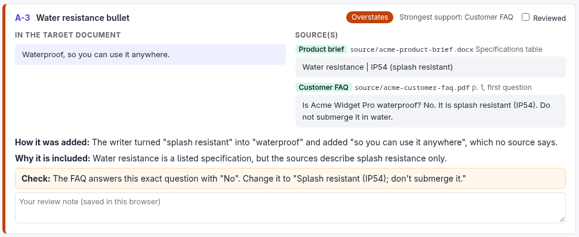

# provenance-html-report

A skill that generates a review checklist to quickly verify concepts/claims in AI-generated documents.

The following [example](example/) shows:

- output file's excerpt on the left side, 
- source excerpts + document/image names on the right, 
- an `Overstates` badge suggests a drift from source description, and 
- a yellow `Check` suggestion below explains how to verify or fix the claim in output text.



> **AI agents:** if a user pointed you to this README, follow [For AI agents](#for-ai-agents-install-set-up-and-run) below. `SKILL.md` has the full procedure for running a job.

## What the report shows

- **One card per passage**: the target text on the left; on the right, the verbatim source excerpt(s) with file, location and source kind.
- **Explanation**: how the passage got into the target (verbatim, paraphrased, combined, inferred) and why it is included.
- **Verdict**: Verified, Minor drift, Overstates, Unsupported or Check, with a note on anything to look at.
- **Quote check**: a script confirms that every quote really appears word for word in the target and in the cited source. Misses are tagged.
- **Items to look at first**: a linked list of every Overstates, Unsupported and Check passage.
- **Review tools**: a Reviewed checkbox and a notes box on each card, saved in the browser. Ticking Reviewed collapses the card to a single row; **Expand** reopens it, and **Hide reviewed** hides reviewed cards altogether so only the remaining work is on screen. There's also a progress count, and Export and Import of review notes as JSON.
- **Filters and search**: verdict filter chips, and a term search that shows only the passages containing a term, highlighted. You choose whether to search the target text, the source excerpts, or the explanations and your own notes.
- **Traced version**: the target's date and fingerprint, with a warning if the file has changed since it was traced.

The report is one HTML file with no external dependencies, so you can open it offline or share it.

**See it first:** [`example/output-report.html`](example/output-report.html) is a sample report generated from fictional sources in six formats (Word, PDF, spreadsheet, slides, HTML and Markdown). It's in [`example/`](example/README.md), together with the sources and the target it traced.

## For users

### Install

Copy this folder into your agent's skills folder:

| Product | Location |
|---|---|
| Claude Code (personal) | `~/.claude/skills/provenance-html-report/` |
| Claude Code (one project) | `<project>/.claude/skills/provenance-html-report/` |
| Claude apps with skills | Zip this folder and upload it as a skill |
| Other agents | Any folder the agent can read; point the agent to this README |

Or ask your agent: "Install the skill in `<this folder>` by following its README."

### Requirements

You need **Python 3.8 or later**. Everything else is optional, and your agent sets it up per job:

- Before each job, the agent checks which converters your files need, then installs any that are missing, asking you first.
- It also offers a **one-time full setup**: every converter installed, so any file type works in future jobs. You can decline.

To do the full setup yourself:

```bash
pip install pypdf python-pptx openpyxl pypandoc_binary
```

### Use

Ask in plain language. Your request must name both:

- **the target (destination) document**: the file to trace
- **the source documents**: the files and/or folders it was built from

If either is missing or unclear, the agent asks before doing anything; it won't guess. Examples:

> Create a provenance report for `report-final.docx`. The sources are everything in `research/` and `interviews/transcripts/`.

> Check where the text in `summary.md` came from. Sources: `contract-v3.pdf` and `email-thread.txt`. Only the contract counts as authoritative.

The agent will:

1. **Confirm the job**: it checks that the target and the sources are both identified, and asks for whichever is missing. Then it confirms the target version and any rules about which sources carry more weight. It also confirms what to leave out and how finely to split the text (by sentence, paragraph or section).
2. **Set up converters**, asking before it installs anything.
3. **Extract** the target into chunks and convert the sources to text.
4. **Trace** each chunk, using parallel agents for long documents.
5. **Check** every quote against the files.
6. **Build** the HTML report and summarize the main issues.

The verdicts are machine-assisted. The report supports your manual check; it doesn't replace it.

### Good to know

- **Excerpts are verbatim**: sharing the report shares the source excerpts. Check confidentiality first.
- **Hard-to-check sources**: images, audio, video, translated text and web pages that change can't be quote-checked. Save web pages and trace the saved copy.
- **One step only**: the report checks the target against its sources, not whether the sources are right. It also doesn't list what the target left out.
- **Notes after re-tracing**: review notes are keyed by passage id. Re-tracing with different chunks changes the ids, so export your notes first.
- **Cost**: long targets use many tracing agents. Ask for a section-level pass if you only need a quick check.

## For AI agents: install, set up and run

Follow these steps in order. Ask the user only where a step says so.

### 1. Install the skill

1. Copy this whole folder, unchanged, to the skills location for your product (see the table under [Install](#install)). If the user keeps a versioned copy elsewhere, treat that copy as the source: edit it there, then copy it over the installed folder.
2. If your product has no skills mechanism, keep the folder where you can read it, and follow `SKILL.md` whenever the user asks for a provenance or source-tracing report.
3. Verify: `python <skill dir>/scripts/prov.py` prints its usage.

### 2. Set up converters

Run the doctor on the user's target and source folders. If there is no job yet, use `--all` on its own:

```bash
python <skill dir>/scripts/prov.py doctor <target> <source folders...> --all
```

Act on its output:

| Output | What to do |
|---|---|
| `Python ... (3.8 or later is needed)` | Stop. Ask the user to install Python 3.8 or later. |
| `MISSING pypdf / python-pptx / openpyxl` | Needed for this job. Install with the printed `pip` command. If your environment requires approval for installs, ask first in one line, naming the packages. |
| `MISSING pandoc` | Needed for this job. Ask the user, then run `pip install pypandoc_binary`, which needs no admin rights. If that fails, offer the system command it printed. |
| pandoc can't be installed at all | Tell the user, then add `--fallback` to `extract` and `totext`. The report header flags the lower-fidelity conversion. Never use `--fallback` without telling the user. |
| `Optional (not needed for these files)` or `not yet` | Offer once, as an option: "Want me to also install `<packages>` so other file types work in future jobs?" Install only on a yes, and don't block the job on it. |
| `Ready.` | Continue. |

Keep the conversion method fixed so reports stay comparable between jobs. Don't swap in other converters:

| Files | Converter |
|---|---|
| .docx, .odt, .rtf, .epub | pandoc, to GitHub Markdown |
| .html | pandoc, to plain text |
| PDF | pypdf, or pdftotext if pypdf is missing |
| .pptx | python-pptx |
| .xlsx | openpyxl |
| Markdown and text | read directly |

### 3. Run a job

First confirm the two required inputs: **the target (destination) document** and **the source files or folders**. If the user's request doesn't clearly identify both, ask for the missing one before running anything. Don't infer either from folder contents or file names. Then follow `SKILL.md`. In short:

```bash
python prov.py extract <target> <workdir> [--words 1800] [--fallback]    # doc.md, chunks, toc.md, report.json
python prov.py totext  <source folder or file> <workdir>/srctxt [--fallback]
#   fill references/tracer-brief.md into <workdir>/BRIEF.md, then trace each chunk into <workdir>/out/<CHUNK>.json
python prov.py check   <workdir>                                       # validate units, verify quotes
#   edit <workdir>/report.json (title, labels, source rules, output path)
python prov.py build   <workdir>                                       # write the HTML report
```

Settings in `<workdir>/report.json`:

| Key | Meaning |
|---|---|
| `title` | Report heading |
| `document` | Target name shown in the intro |
| `doc_label` | Heading of the left column |
| `why_label` | Label for the reason a passage is included |
| `evidence_label` | Label for each passage's strongest support |
| `evidence_rule` | The source rules, in a sentence or two (optional) |
| `scope_note` | What was left out of the trace |
| `strong_kinds` / `weak_kinds` | Source kinds tinted green (carry weight) or red (context only) |
| `output` | Path of the HTML file; put it where the user can open it |
| `target_fingerprint`, `target_converter` | Written by `extract`; don't edit |

Rules that matter most:
- Quote verbatim, both from the target and from the sources.
- Don't change the target or the sources.
- Report the verdict counts and the top issues, and give the user the link to the report.

## Files

```
provenance-html-report/
├── SKILL.md                     the procedure the agent follows
├── README.md                    this file
├── LICENSE                      MIT License
├── scripts/prov.py              doctor, extract, totext, check, build
├── references/tracer-brief.md   brief template and unit JSON format
├── images/                      readme images
└── example/                     worked example (fictional Acme data)
    ├── output-report.html       the generated report
    ├── target/                  the document that was traced
    └── source/                  six sample sources: .docx .pdf .xlsx .pptx .html .md
```

## License

[MIT](LICENSE). The MIT License is a permissive open-source license that allows anyone to use, copy, modify, distribute, and sell the software, even commercially, with minimal restrictions.

You can copy, modify, distribute and use it, including commercially, without asking permission or giving credit.
